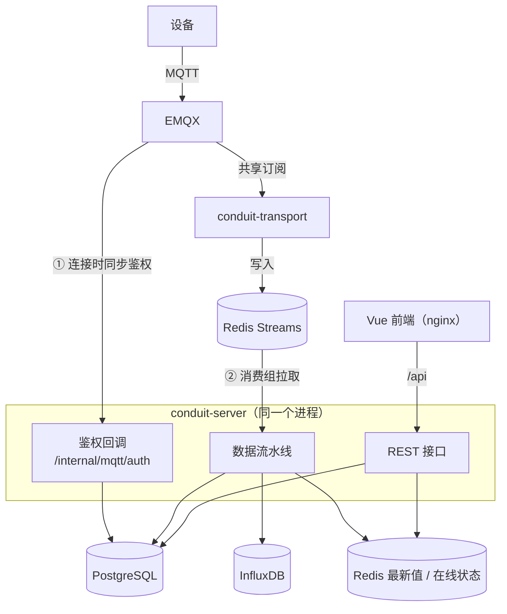
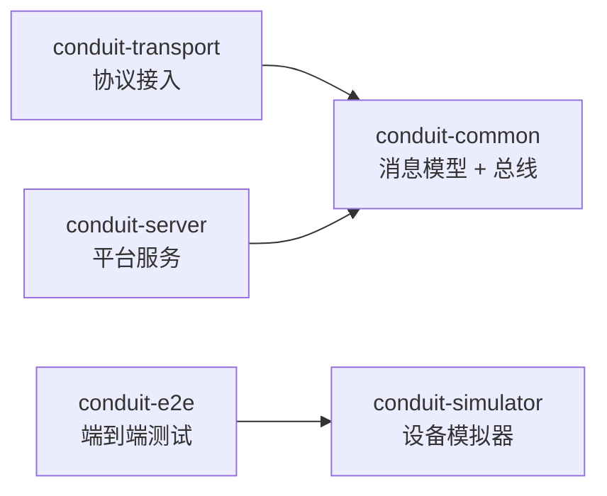

# Conduit

个人研究性质的 IoT 平台。V0.1 跑通「设备 MQTT 直连 → 接入 → 总线 → 处理 → 时序存储 → Web 展示」主链路。

设计文档：`docs/superpowers/specs/2026-10-14-conduit-v0.1-design.md`（版本路线与 V0.1）、`docs/superpowers/specs/2026-10-15-conduit-v0.2a-thing-model-design.md`（V0.2-A 物模型与编解码）

设备接入指南（流程、连接参数、上报格式、示例代码、排错）：[`docs/device-integration.md`](docs/device-integration.md)

## 架构



`conduit-server` 只有一个进程，但有两个入口：

- **① 鉴权回调（控制面）**：设备建立 MQTT 连接时，EMQX 同步调用它，拿到 allow / deny 才放行。频率低，每次连接一次。server 不可用时新设备连不上，已连接的设备不受影响。
- **② 数据流水线（数据面）**：设备每条上报都先经 transport 写入 Redis Streams，server 以消费组身份异步拉取、处理、入库后再确认。server 重启期间消息在 Redis 中排队，恢复后继续处理，不丢数据。

设备数据从不直连 server，所以 server 重启或变慢不会堵住 EMQX；新增协议也只需在 transport 侧加适配器。完整接入流程见[设备接入指南](docs/device-integration.md)。

## 代码结构

仓库根目录即 Maven 父工程，Java 模块与前端 `conduit-ui` 平铺在顶层。Java 模块之间的依赖关系：



`transport` 和 `server` 之间没有代码依赖，只通过 `common` 里定义的消息格式和 Redis Streams 通信。

```
conduit/
├── pom.xml                          Maven 父工程（JDK 21，Spring Boot 3.5），聚合下列 conduit-* Java 模块
├── Dockerfile                       构建 Java 应用镜像（构建参数 MODULE 指定模块）
├── conduit-common/                  dev.conduit.common
│   ├── message/                     RawMessage：协议无关的统一消息，及其与 Stream 字段的编解码
│   └── bus/                         MessageBus 接口和 Redis Streams 实现（投递、消费组、认领、死信）
├── conduit-transport/               dev.conduit.transport（端口 8081）
│   ├── adapter/                     ProtocolAdapter 接口；新增协议就是新增一个实现
│   └── mqtt/                        MQTT 适配器：共享订阅、写入总线成功后才确认、topic 解析
├── conduit-server/                  dev.conduit.server（端口 8080），按业务领域分包
│   ├── auth/                        登录、JWT、Spring Security 配置
│   ├── tenant/                      租户上下文与租户隔离
│   ├── product/  device/            产品、设备的增删改查和接口
│   ├── mqttauth/                    EMQX 鉴权回调
│   ├── pipeline/                    数据流水线：消费总线、按物模型逐测点校验、重试、死信
│   │   └── codec/                   可插拔解码器（标准 JSON、扁平 JSON）
│   ├── thingmodel/                  物模型：属性增删改查、导入导出、按产品缓存
│   ├── telemetry/                   InfluxDB 写入、最新值存储与查询
│   ├── presence/                    设备上下线状态
│   ├── security/  bootstrap/        密钥生成与哈希；启动时创建默认租户和管理员
│   └── config/  web/                框架配置；统一错误响应、分页
├── conduit-simulator/               dev.conduit.simulator：通过 REST 开通设备，再按周期上报
├── conduit-e2e/                     端到端测试（-Pe2e 时才参与构建）
├── conduit-ui/                      Vue 3 + TypeScript + Element Plus（独立 npm 工程，自带 Dockerfile）
│   └── src/  api/  stores/  router/  layouts/  views/  components/  composables/  utils/
├── deploy/                          docker-compose.yml、.env.example、EMQX 鉴权与 ACL 配置
├── docs/                            设备接入指南、待办清单、设计文档与实现计划
└── .run/                            IntelliJ IDEA 共享运行配置
```

## 一键演示

需要 Docker（本机或远程均可；远程时先设置 `DOCKER_HOST=tcp://<docker-host>:2375`；该端口是无认证的 Docker API，仅限可信局域网使用）。

> **安全提示**
>
> - `.env` 中所有 `change-me-*` 值必须在宿主机可被他人访问之前替换掉，例如用 `openssl rand -hex 32` 生成。
> - 端口默认只绑定 `127.0.0.1`。Docker 宿主机是远程机器、或需被其他机器访问时，在 `.env` 中设置 `BIND_ADDR=0.0.0.0`，并确保网络可信。
> - API 端口同时暴露 `/internal/mqtt/auth`（EMQX 鉴权回调，受内部 token 保护）和健康检查端点。
> - `EMQX_DASHBOARD_PASSWORD` 仅在首次启动（`emqx-data` 卷为空）时生效；之后修改请在控制台中操作，或 `down -v` 清卷重来。

```bash
cp deploy/.env.example deploy/.env   # 按需修改口令与端口
docker compose -f deploy/docker-compose.yml --profile demo up -d --build
```

Docker 宿主机无法访问外网时（镜像内的 `mvn` / `npm ci` 下载不了依赖），改用本机构建：

```bash
deploy/build-local.sh
```

脚本从当前提交的干净检出构建 jar 和前端（未提交的修改与 `application-local.yml` 等本地配置不会进入镜像），在宿主机上只打复制产物的薄镜像，再执行 `up -d --no-build`。需要本机有 JDK 21 上的 Maven 和 Node.js 22，宿主机上已有 compose 用到的基础镜像（`eclipse-temurin:21.0.6_7-jre`、`nginx:1.27.4-alpine` 以及 postgres、redis、influxdb、emqx）。`--no-up` 只构建不启动；docker / compose 命令可用环境变量 `DOCKER`、`COMPOSE` 覆盖。

浏览器打开 `http://<docker-host>:8090`（Docker 在本机时为 `localhost`），用 `.env` 中的 `CONDUIT_ADMIN_USERNAME` / `CONDUIT_ADMIN_PASSWORD` 登录。模拟器会自动创建「三相电表（演示）」产品和设备（设备名形如「1号楼配电室 电表01」，每栋楼 10 台；已有设备的旧名称会在启动时改成这种格式，Key 不变），并在产品没有属性时导入演示物模型（docs/examples/demo-meter.thing-model.json）（默认 100 台，每 10 秒上报一次，见 `SIM_DEVICE_COUNT` / `SIM_INTERVAL_MS`；上报格式由 `SIM_PAYLOAD_FORMAT`（`standard` / `flat`）指定，新建产品时按此选用解码器，已有产品的解码器不会被修改）。

宿主机端口可在 `deploy/.env` 中配置，括号内为默认值：

| 变量 | 服务 |
|---|---|
| `WEB_PORT`（8090） | Web |
| `API_PORT`（8091） | REST API |
| `MQTT_PORT`（1883） | MQTT |
| `EMQX_DASHBOARD_PORT`（18083） | EMQX 控制台 |
| `INFLUX_PORT`（8096） | InfluxDB 3 Core HTTP API（容器内 8181，需 token） |
| `POSTGRES_PORT`（15432） | PostgreSQL（供 IDE 中运行的服务直连） |
| `REDIS_PORT`（16379） | Redis（同上） |

### InfluxDB 3 Core

- 镜像 `influxdb:3.12.0-core`，数据库 `telemetry`，保留 30 天（conduit-server 启动时建库）。
- `INFLUX_TOKEN` 必须以 `apiv3_` 开头，容器启动时据此生成离线管理员 token。首次启动时写入库中，之后修改 INFLUX_TOKEN 不会生效：需停止服务、删除 `conduit_influx3-data` 卷（时序数据随之清空）后重新启动。
- 从 V0.1（InfluxDB 2.7）升级：新版本使用新卷 `conduit_influx3-data`，旧卷 `conduit_influx-data` 中的历史数据**不迁移**；确认不需要后可执行 `docker volume rm conduit_influx-data`。
- 查询示例：

  ```bash
  curl -s -H "Authorization: Bearer <INFLUX_TOKEN>" --get "http://<docker-host>:8096/api/v3/query_sql" \
    --data-urlencode "db=telemetry" --data-urlencode "format=json" \
    --data-urlencode "q=SELECT time, device_key, \"Ua\" FROM property ORDER BY time DESC LIMIT 5"
  ```

## 设备接入

- 连接：`clientId = username = deviceKey`，`password = deviceSecret`（创建或重置设备时显示一次）
- 上报：QoS1 发布到 `conduit/{productKey}/{deviceKey}/up/property`

```json
{ "id": "可选", "ts": 1760400000000, "params": { "Ua": 220.1, "Ia": 5.2 } }
```

- 产品可选解码器「标准 JSON」（上面的格式）或「扁平 JSON」（`{"ts":…,"Ua":220.1}`），并可定义物模型逐测点校验，详见 [设备接入指南](docs/device-integration.md)。

## 开发

```bash
mvn verify
```

```bash
cd conduit-ui && npm install && npm test && npm run dev
```

### 在 IDE 中运行（连接已部署的 Compose 环境）

server、transport、simulator 和前端都可以直接在 IDEA 里运行，连接「一键演示」起来的 PostgreSQL、Redis、InfluxDB、EMQX。

1. 用 IDEA 打开仓库根目录，把根目录的 `pom.xml` 作为 Maven 工程导入，Project SDK 选 **JDK 21**。仓库自带的运行配置（`.run/`）会自动出现：

   | 运行配置 | 作用 |
   |---|---|
   | `Conduit Server (local)` | `ServerApplication`，已带 `-Dspring.profiles.active=local` |
   | `Conduit Transport (local)` | `TransportApplication`，同上 |
   | `Conduit Simulator (local)` | `SimulatorApplication`，读取 `simulator-local.properties` |
   | `Conduit UI (local)` | 在 `conduit-ui/` 下执行 `npm run dev`（首次先 `npm install`） |
   | `Conduit (local all)` | 一次启动 Server、Transport、UI |

2. 确认 `.env` 中 `BIND_ADDR`、`POSTGRES_PORT`（默认 15432）、`REDIS_PORT`（默认 16379）已按需设置，并执行过一次 `up -d`，让 PostgreSQL 和 Redis 端口对宿主机开放。
3. 在 `conduit-server/src/main/resources/` 和 `conduit-transport/src/main/resources/` 下各新建一个 `application-local.yml`，写入 Docker 宿主机地址、端口和 `.env` 中的口令。这个文件已在 `.gitignore` 中，不会被提交。

   > 注意：本版本起模块已由 `conduit-connector` 改名为 `conduit-transport`。已有的本地 `application-local.yml` 需要移到 `conduit-transport/src/main/resources/`，并把配置前缀改为 `conduit.transport.mqtt`；server 侧的 `conduit.internal.connector-password` 也已改为 `transport-password`。

   ```yaml
   # conduit-server/application-local.yml
   spring:
     datasource:
       url: jdbc:postgresql://<docker-host>:15432/conduit
       password: <POSTGRES_PASSWORD>
     data:
       redis:
         host: <docker-host>
         port: 16379
   conduit:
     bootstrap:
       admin-password: <CONDUIT_ADMIN_PASSWORD>
     auth:
       jwt-secret: <CONDUIT_JWT_SECRET>
     internal:
       token: <CONDUIT_INTERNAL_TOKEN>
       transport-password: <TRANSPORT_MQTT_PASSWORD>
     influx:
       url: http://<docker-host>:8096
       token: <INFLUX_TOKEN>   # apiv3_ 开头
   ```

   ```yaml
   # conduit-transport/application-local.yml
   spring:
     data:
       redis:
         host: <docker-host>
         port: 16379
   conduit:
     transport:
       mqtt:
         host: <docker-host>
         port: 1883
         client-id: conduit-transport-idea   # 必须以 conduit- 开头
         session-expiry-seconds: 0           # 必须为 0，见下方说明
         username: <TRANSPORT_MQTT_USERNAME>
         password: <TRANSPORT_MQTT_PASSWORD>
   ```

4. 模拟器不是 Spring 应用，在 `conduit-simulator/src/main/resources/` 下新建 `simulator-local.properties`（同样不入库），键名与环境变量相同，环境变量优先：

   ```properties
   CONDUIT_API_URL=http://localhost:8080
   CONDUIT_ADMIN_USERNAME=<CONDUIT_ADMIN_USERNAME>
   CONDUIT_ADMIN_PASSWORD=<CONDUIT_ADMIN_PASSWORD>
   MQTT_HOST=<docker-host>
   MQTT_PORT=1883
   # 不要用「三相电表（演示）」：模拟器启动时会重置该产品下设备的密钥并改名，会影响容器里的演示设备
   SIM_PRODUCT_NAME=IDEA Meter
   SIM_DEVICE_COUNT=5
   SIM_INTERVAL_MS=5000
   ```

5. 先启动 `Conduit Server (local)`，再按需启动 Transport、Simulator、UI。前端默认把 `/api` 代理到本机 8080；要直接连远程 server，可设置环境变量 `VITE_API_TARGET=http://<docker-host>:8091`。

说明：IDE 中的实例与容器中的实例同时运行时，会加入同一个消费组分担消息、加入同一个共享订阅分担上报，数据不会重复也不会丢；设备鉴权仍由容器里的 server 完成。本地 transport 的 `session-expiry-seconds` 必须设为 0：它加入了和容器 transport 相同的共享订阅组，如果使用持久会话，进程停止后 EMQX 仍会把一部分设备消息分给这个已离线的会话，这些消息要等会话过期（默认 1 小时）才会被丢弃，期间相当于丢数据。需要只让本地 transport 收消息时，可以 `docker compose -f deploy/docker-compose.yml stop conduit-transport`；不要停容器里的 `conduit-server`，否则 EMQX 的鉴权回调无处可去，新设备将无法连接。

## 端到端测试：杀进程不丢数据

10 台设备各发 50 条消息，发送中途 kill 并重启 `conduit-server`，最终 InfluxDB 中应恰好 500 条。需要 Compose 环境已启动（不带 demo profile 亦可）。不要同时运行两个 e2e：它们共用同一个 conduit-server，一个 kill 它会让另一个连接失败。

```bash
mvn install -DskipTests
mvn verify -Pe2e -pl conduit-e2e
```

测试读取 `deploy/.env` 中的凭证与端口，并支持环境变量：

| 变量 | 默认 | 说明 |
|---|---|---|
| `E2E_HOST` | `localhost` | Docker 主机地址（远程 Docker 时填其地址） |
| `E2E_COMPOSE` | `docker compose` | compose 命令，例如独立二进制的完整路径；子进程继承 `DOCKER_HOST` |

失败时的诊断命令（在 Compose 所在的 Docker 上执行）：

```bash
docker compose -f deploy/docker-compose.yml exec redis redis-cli XLEN conduit:stream:dead
docker compose -f deploy/docker-compose.yml exec redis redis-cli XRANGE conduit:stream:dead - + COUNT 5
docker compose -f deploy/docker-compose.yml exec redis redis-cli XPENDING conduit:stream:up conduit-server
```

## 已知限制

- 物模型缓存为进程内缓存：多实例部署时，修改物模型最多 60 秒后在其他实例生效。
- 未启用 TLS；凭证均为演示用途。
- Redis 长时间不可用时，EMQX 会话队列（`max_mqueue_len`）溢出会丢消息，V1.0 压测时量化。
- 死信只能通过 `redis-cli XRANGE conduit:stream:dead - +` 查看。
