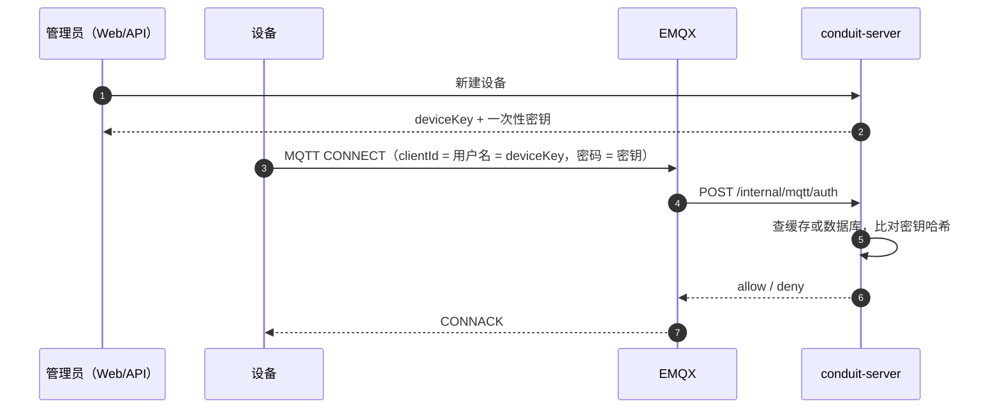
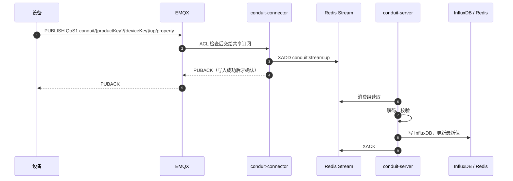

# 设备接入指南

本文说明一台设备从开通、连接到数据上报的完整流程，以及对接时需要遵守的约定。内容对应 V0.1 的实际实现。

## 1. 整体流程

设备接入分两段：先开通和鉴权，之后才能上报数据。



连接成功后，每条数据按下面的链路流转。每一跳都在下游确认收到之后才向上游确认，所以任一环节重启都不会丢数据，最多重复一次（重复数据会被幂等吸收）。



设备上下线不需要设备自己上报：EMQX 的连接、断开事件经 connector 进入同一条总线，由 server 更新在线状态。

## 2. 准备：产品和设备

设备必须挂在某个产品下。可以在 Web 界面操作（「产品」页新建产品，「设备」页新建设备），也可以直接调用 REST 接口：

```bash
API=http://<docker-host>:8090   # 经 nginx 代理；也可直连 API_PORT（默认 8091）

TOKEN=$(curl -s -X POST "$API/api/v1/auth/login" -H 'Content-Type: application/json' \
  -d '{"username":"<管理员用户名>","password":"<管理员密码>"}' | jq -r .accessToken)

# 新建产品，记下返回的 productKey
curl -s -X POST "$API/api/v1/products" -H "Authorization: Bearer $TOKEN" \
  -H 'Content-Type: application/json' -d '{"name":"三相电表"}'

# 新建设备，记下返回的 device.deviceKey 和 deviceSecret
curl -s -X POST "$API/api/v1/devices" -H "Authorization: Bearer $TOKEN" \
  -H 'Content-Type: application/json' -d '{"productKey":"<productKey>","name":"1 号表"}'
```

> deviceSecret 只在新建或重置密钥时返回一次，平台只保存它的哈希。丢失后只能在「设备」页点「重置密钥」，重置后旧密钥立即失效。

## 3. 连接参数

| 参数 | 取值 |
|---|---|
| 地址 | Docker 宿主机地址 |
| 端口 | `MQTT_PORT`，默认 1883（V0.1 未启用 TLS） |
| 协议 | MQTT 3.1.1 或 5 |
| clientId | deviceKey |
| 用户名 | deviceKey（必须与 clientId 相同） |
| 密码 | deviceSecret |
| 建议 keepalive | 60 秒 |

设备详情页的「连接参数」卡片会显示同样的内容，可以直接照抄。

**权限**：设备只能向自己的上行 topic `conduit/+/{deviceKey}/up/#` 发布，只能订阅自己的下行 topic `conduit/+/{deviceKey}/down/#`。往别的设备 topic 发会被 EMQX 拒绝。

## 4. 上报格式

**Topic**：`conduit/{productKey}/{deviceKey}/up/property`，QoS 使用 1。

**Payload**（UTF-8 JSON）：

```json
{
  "id": "可选，消息 ID，只用于追踪",
  "ts": 1760400000000,
  "params": { "Ua": 220.1, "Ia": 5.2, "EPimp": 12345.6, "mode": "auto", "alarm": false }
}
```

| 字段 | 规则 |
|---|---|
| `ts` | 采样时间，**毫秒**时间戳。可省略，省略时用平台接收时间。必须在 `[当前时间 − 30 天, 当前时间 + 5 分钟]` 之内，秒级时间戳会被当作超出范围 |
| `params` | 非空对象，值只能是数字、字符串、布尔，不能是 null、数组或嵌套对象 |
| 测点名 | 不能为空，不能以 `__` 开头（平台保留） |
| 数字 | 一律按浮点数存储，`220` 和 `220.0` 等价 |
| 类型一致 | 同一测点一旦以数字写入，之后就不能再报字符串，反之亦然 |

同一设备、同一 `ts` 重复上报会覆盖为同样的值，因此设备重发是安全的。补传的旧数据会写入历史，但不会覆盖页面上的最新值。

## 5. 对接示例

**命令行（mosquitto_pub）**

```bash
mosquitto_pub -h <docker-host> -p 1883 -q 1 \
  -i <deviceKey> -u <deviceKey> -P <deviceSecret> \
  -t conduit/<productKey>/<deviceKey>/up/property \
  -m "{\"ts\":$(date +%s%3N),\"params\":{\"Ua\":220.1,\"Ia\":5.2}}"
```

**Python（paho-mqtt 2.x）**

```python
import json, time
import paho.mqtt.client as mqtt

HOST, PORT = "<docker-host>", 1883
PRODUCT_KEY, DEVICE_KEY, SECRET = "<productKey>", "<deviceKey>", "<deviceSecret>"
TOPIC = f"conduit/{PRODUCT_KEY}/{DEVICE_KEY}/up/property"

client = mqtt.Client(mqtt.CallbackAPIVersion.VERSION2, client_id=DEVICE_KEY)
client.username_pw_set(DEVICE_KEY, SECRET)
client.connect(HOST, PORT, keepalive=60)
client.loop_start()

while True:
    payload = {"ts": int(time.time() * 1000), "params": {"Ua": 220.1, "Ia": 5.2}}
    info = client.publish(TOPIC, json.dumps(payload), qos=1)
    info.wait_for_publish()          # 等平台确认（PUBACK）后再发下一条
    time.sleep(10)
```

仓库里的设备模拟器 `backend/conduit-simulator` 是一个完整的 Java 参考实现，使用 HiveMQ MQTT Client，支持断线重连和发送失败重试。

## 6. 核对结果

- **Web**：「设备」页能看到设备「在线」，「最后上报」时间在更新；进入设备详情，最新值表格每 5 秒刷新一次。
- **API**：`GET /api/v1/devices/{deviceKey}/latest` 返回各测点的最新值和采样时间。

## 7. 常见问题

**连接被拒绝（CONNACK 返回未授权）**

- clientId 和用户名不一致，或者都不是 deviceKey。
- 密钥错误，或者已经重置过。
- 设备在平台上被禁用。
- 平台侧配置问题：`CONDUIT_INTERNAL_TOKEN` 在 EMQX 和 server 之间不一致。

**能连上，但页面上看不到数据**

消息到达平台后如果校验不通过，会进入死信队列，不会重试。可以这样查看最近几条死信及原因：

```bash
docker compose -f deploy/docker-compose.yml exec redis \
  redis-cli XREVRANGE conduit:stream:dead + - COUNT 5
```

| 死信原因 | 常见原因 |
|---|---|
| `MALFORMED_JSON` | payload 不是合法 JSON 对象，或有重复键 |
| `INVALID_PARAMS` | `params` 为空、值类型不支持、测点名非法、数值溢出 |
| `TS_OUT_OF_RANGE` | 用了秒级时间戳，或设备时钟偏差过大 |
| `PRODUCT_MISMATCH` | topic 里的 productKey 和设备所属产品不一致 |
| `UNKNOWN_DEVICE` / `DEVICE_DISABLED` | 设备已删除或已禁用（禁用不会断开已有连接） |
| `FIELD_TYPE_CONFLICT` | 同一测点前后报了不同类型 |
| `UNSUPPORTED_TYPE` | 发到了 `up/event`，V0.1 暂不支持事件 |
| `PROCESSING_ERROR` | 平台内部处理异常，只影响这一条消息 |
| `MAX_DELIVERY_EXCEEDED` | 同一条消息投递超过 5 次仍未处理成功 |

**发出去的消息没有收到 PUBACK**

平台下游（Redis）暂时不可用时，connector 会暂缓确认，设备侧表现为 PUBACK 变慢。恢复后会继续确认，消息不会丢失。设备应等待 PUBACK，不要因为超时就丢弃数据。

## 8. V0.1 的限制

- 只支持属性上报（`up/property`）；事件上报、下行命令、设备影子在后续版本提供。
- 未启用 TLS，凭证在网络中明文传输，只适合内网和演示环境。
- 禁用设备不会立即断开它已有的 MQTT 连接，之后上报的数据会进入死信。
- 只支持 MQTT 直连；HTTP、Modbus TCP 等协议计划在 V1.1 提供。
